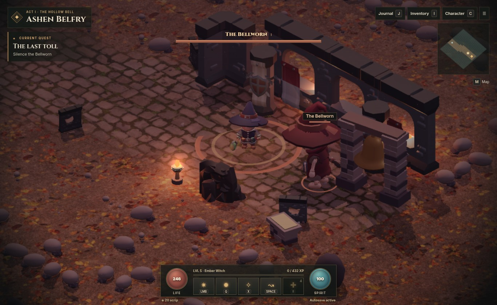

# Ash & Iron

**Act I · The Hollow Bell**

The bell beneath Gloamwatch has rung for the first time in a century. Follow the cinder road, recover the seals of ash and iron, and silence the Bellworn before the dead reach the gates.

Ash & Iron is an original single-player isometric 3D action RPG. Act I follows a complete quest through Gloamwatch, Cinderwood, the Reliquary, and Ashen Belfry, with an optional descent into Blackroot Vault.



[Gloamwatch screenshot](docs/gloamwatch.jpg)

## Play

Download [Ash-and-Iron.html](https://github.com/thongntit/ash-and-iron/releases/latest/download/Ash-and-Iron.html) and open it in a current desktop browser with WebGL 2. The game runs offline. Your journey saves in that browser, so keep the file in the same location to continue. Desktop mouse and keyboard are the primary controls. On a touch screen, tap the world to move, attack, or interact and use the buttons in the HUD for skills.

| Action | Controls |
| --- | --- |
| Move | Click the ground, WASD, or arrow keys |
| Attack | Click an enemy to engage or **Shift + click**/**F** to attack toward the cursor in place |
| Class skill | **Q** or right click |
| Tactical skill | **X** |
| Zoom | Mouse wheel |
| Dodge | **Space** toward movement or the cursor |
| Use a healing draught | **R** |
| Interact | Click a character, shrine, or gate, or press **E** nearby |
| Open menus | **I** inventory, **C** character, **J** journal, **M** map, **Esc** pause |

Choose the **Warden** for melee cleaves, the **Ember Witch** for ranged fire and area damage, or the **Hollow Scout** for piercing crossbow bolts. Each class has a tactical skill for guarding, blinking, or trapping foes. Walk over loot to pick it up, then equip it from the inventory. Spend talent points from the character screen. Smith Oren buys and sells gear, and the rest shrine at Gloamwatch restores life and refills the first three draught slots. The gold diamond on the map points to the next quest objective. Click the gold off-screen indicator to walk toward it. Talk to Oren for the missing ledger commission. Follow the path beyond the courier’s camp to challenge the Oathbreaker and claim Blackroot’s ward.

## Build and test

Requires Node.js 20.19+ or 22.12+.

```sh
npm ci
npm run dev
```

```sh
npm test
npm run build
npx playwright install chromium
npm run test:browser
```

`dist/index.html` is the web build entry point and `dist/Ash-and-Iron.html` is the standalone download. Use `npm run preview` to serve the web build locally. The campaign tests check the complete quest and boss fight, saved progress, all three classes, death recovery, the courier commission, and Blackroot Vault. The Chromium tests exercise the production build and the offline HTML.

## Asset credits

The game uses Three.js with an orthographic camera, skeletal animation, dynamic lighting, and 3D combat effects. The standalone download includes the meshes, textures, and sound files.

- Adventurers, skeletons, dungeon pieces, and medieval buildings by Kay Lousberg. [KayKit](https://github.com/KayKit-Game-Assets)
- Trees and foliage by Quaternius. [Ultimate Stylized Nature](https://quaternius.com/packs/ultimatestylizednature.html)
- Cobblestone by Rob Tuytel and forest floor by eye-candy.xyz. [Cobblestone Floor 04](https://polyhaven.com/a/cobblestone_floor_04) · [Forest Floor](https://polyhaven.com/a/forest_floor)
- Ambience and sword effects by Ruhinre, yd, and StarNinjas. [Asset sources and licenses](public/licenses/asset-sources.txt)

These game assets are CC0. The title illustration was generated for Ash & Iron. The fonts retain their SIL Open Font Licenses. [License files](public/licenses) · [Font notices](public/fonts)
